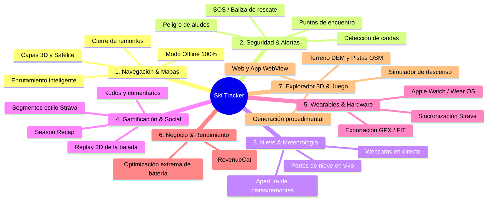

# 🗺️ Roadmap de Producto - Ski Tracker

Bienvenido a la hoja de ruta (**Roadmap**) integral de **Ski Tracker**. Este documento recopila todas las funcionalidades, mejoras técnicas y casos de uso de alto impacto organizados en formato de lista de tareas (**TODO**) para facilitar el seguimiento del desarrollo y convertir la app en la plataforma de referencia para deportes de nieve y actividades outdoor.

---

## 🧭 Visión del Producto

Evolucionar de un registrador de rutas GPS a un **asistente integral e inteligente de montaña y outdoor**:
- **En pistas:** Navegación guiada, seguridad activa, optimización del tiempo de esquí y mapas 100% offline.
- **En comunidad:** Experiencia social compartida, retos grupales, tablas clasificatorias y seguridad mutua.
- **Post-actividad:** Analítica visual avanzada (replay 3D, desgloses por pista, perfiles altimétricos y resúmenes compartibles).
- **Todo el año:** Soporte multi-deporte (senderismo, ciclismo, viajes) manteniendo el invierno como núcleo de máxima especialización.

---

## 📊 Estado Actual vs. Próximas Fases

| Área | Estado Actual (v1.x - v2.0-beta) | Próximo Salto Cualitativo |
| :--- | :--- | :--- |
| **Tracking** | Multi-actividad, segmentación nieve vs outdoor, HUD dinámico, buffer SQLite | Algoritmo adaptativo en frío (-10°C), menor consumo GPS, detección de paradas inteligente |
| **Mapas & Pistas** | MapLibre (2D/3D con sombras DEM), POIs y servicios, cálculo de rutas Dijkstra con filtros por nivel, clima y rapidez, paquetes offline 100% descargables por estación con soporte completo en mapa y tracking | Visualización de partes de nieve y estado abierto/cerrado en tiempo real |
| **Social** | Amigos, solicitudes, feed comunitario básico, live location en mapa | Reacciones (kudos), comentarios, leaderboards por estación, puntos de encuentro |
| **Meteo** | Integración básica Open-Meteo (temperatura, viento, rachas) | Partes de nieve (snow reports), webcams integradas, cota de nieve en tiempo real |
| **Analítica** | Métricas agregadas (desnivel, velocidad máx/media, lista de bajadas) | Reproductor 3D de ruta (Relive), comparador de bajadas, segmentos cronometrados |
| **Plataformas** | React Native (Expo) Android / iOS / Web | Wearables (relojes inteligentes), exportación e importación GPX/Strava |
| **Simulador 3D** | Ninguno | Explorador interactivo procedimental en Three.js con estaciones, pistas y remontes reales |

---

## 🏔️ 1. Navegación en Pistas y Cartografía Avanzada

- [x] **1.1 Descarga de Mapas y Pistas Offline (100% Sin Cobertura)**
  - **Utilidad:** En la alta montaña o en estaciones fuera de la UE (Andorra, Suiza, etc.), la cobertura móvil es deficiente o conlleva sobrecostes de roaming. Poder descargar una estación completa antes de salir del hotel es crítico.
  - **Detalle de Implementación:**
    - [x] **Frontend:** Descarga local de paquetes con teselas vectoriales (MBTiles) y geometrías GeoJSON de pistas, remontes y POIs en el dispositivo. La idea es que al funcionar offline no se compruebe tokens, pero tampoco sean visibles las pestañas que requieren internet, solamente el tracking y el mapa. Se debe poder navegar entre las pestañas de mapa y tracking, por ejemplo, para ver los pois en el mapa y ver las bajadas actuales que llevo en el tracking.
    - [x] **Backend:** Endpoint para empaquetar o servir paquetes offline pre-generados por estación (`/api/v1/resorts/:id/offline-pack`).
  - **Prioridad:** 🔴 Alta | **Complejidad:** L

- [x] **1.2 Enrutamiento Guiado por Nivel de Habilidad (Smart Ski Routing)**
  - **Utilidad:** Mejorar el calculador de rutas existente con filtros prácticos:
    - [x] *"Ruta fácil / debutantes":* Evitar estrictamente pistas rojas y negras.
    - [x] *"Ruta rápida":* Minimizar tiempo de remontes lentos (priorizar telesillas desembragables y telecabinas).
    - [x] *"Ruta con mal tiempo":* Evitar remontes abiertos a cotas altas con viento.
    - [x] *"Volver a la base antes del cierre":* Calcular automáticamente a qué hora emprender el regreso hacia el coche/apartamento.
  - **Detalle de Implementación:**
    - [x] Ajuste de pesos en el grafo de enrutamiento ([`ski-routing.util.ts`](file:///home/development/projects/ski-tracker/apps/web/utils/ski-routing.util.ts)) ponderando la dificultad de pistas y tipología de remontes.
  - **Prioridad:** 🔴 Alta | **Complejidad:** M

- [x] **1.3 Alerta de Cierre de Remontes**
  - **Utilidad:** Los remontes cierran habitualmente entre las 16:15 y las 17:00. Si un esquiador se encuentra en otro valle, corre el riesgo de quedarse atrapado. La app alerta con antelación: *"Debes tomar el remonte X antes de las 16:10 para regresar a tu zona de origen"*.
  - **Prioridad:** 🟡 Media | **Complejidad:** M

- [x] **1.4 Renderizado de Relieve 3D con Sombras de Terreno (Terrain Mesh)**
  - **Utilidad:** Visualizar en MapLibre la pendiente real y las crestas montañosas mediante teselas DEM (Digital Elevation Model), facilitando la orientación en valles complejos.
  - **Prioridad:** 🟢 Baja | **Complejidad:** M

---

## 🛡️ 2. Seguridad en Montaña y Rescate (Safety First)

- [ ] **2.1 Detección Automática de Caídas / Impactos (Crash Detection)**
  - **Utilidad:** Detectar deceleraciones bruscas o caídas a alta velocidad mediante los sensores del smartphone (acelerómetro y giroscopio) seguidas de inmovilidad.
  - **Flujo:**
    - [ ] 1. La app emite una alarma sonora y vibración con una cuenta atrás de 45 segundos.
    - [ ] 2. Si el usuario no cancela la alerta, se activa el protocolo de emergencia (envío de SMS o notificación push con coordenadas exactas a los amigos o contactos de confianza).
  - **Prioridad:** 🟡 Media | **Complejidad:** L

- [ ] **2.2 Baliza SOS y Enlace Rápido 112 / Pistas**
  - **Utilidad:** Botón de auxilio rápido que muestra en pantalla completa:
    - [ ] Coordenadas geográficas exactas en formato estándar de rescate (grados, minutos y segundos).
    - [ ] Nombre de la pista actual y estación donde se encuentra.
    - [ ] Teléfono directo de los servicios de socorro en pistas de la estación activa.
    - [ ] Envío automático de SMS / WhatsApp a contactos de emergencia preconfigurados con un clic.
  - **Prioridad:** 🔴 Alta | **Complejidad:** S

- [x] **2.3 Puntos de Encuentro Grupales en el Mapa ("Meeting Points")**
  - **Utilidad:** Fijar un punto geográfico temporal en el mapa (ej. *"Comida en Restaurante Borreguiles a las 14:00"* o *"Nos vemos abajo del telesilla"*).
  - **Detalle:** Visible en tiempo real para todos los amigos del grupo, mostrando la distancia y la ruta de esquí para llegar.
  - **Prioridad:** 🟡 Media | **Complejidad:** S

---

## ❄️ 3. Información de Nieve, Meteorología y Previsión de Nevadas

- [x] **3.1 Previsión de Nevadas, Espesores y Tiempo Detallado (Open-Meteo)**
  - **Utilidad:** Proporcionar información meteorológica y de nieve en alta resolución para planificar las jornadas de esquí:
    - [x] Espesor de nieve acumulada en cota base y cota cumbre (Open-Meteo dual-elevation batch query).
    - [x] Previsión de nevadas acumuladas a 7 días y desglose diario de días con nevadas previstas (fechas, cm y temperaturas mín/máx).
    - [x] Acumulado de nieve reciente en últimas 24h, 48h y fecha/centímetros de la última nevada detectada en el histórico de 7 días.
    - [x] Tipo y calidad de nieve (polvo, dura/venteada, primavera, húmeda, polvo dura) calculado a partir de temperaturas, nevadas recientes y viento.
    - [x] Cota de congelación / isocero 0ºC (`freezing_level_height`).
    - [x] Boletín de Peligro de Aludes (BPA): Estimación en escala europea (1 a 5), cota crítica, laderas sotavento peligrosas por sobrecarga de viento y nieve reciente, integrado como sección dentro del apartado de nieve y nevadas.
  - **Detalle de Implementación:**
    - [x] **Backend:** Extensión de `WeatherService` y `WeatherHandler` con soporte para multi-elevación (`baseElev` y `summitElev`) y cálculo de `SnowReport`. Sistema de caché en memoria de 1 hora (`gin-contrib/cache`) por estación/coordenadas para proteger los límites de la API pública de Open-Meteo.
    - [x] **Frontend:** Integración unificada dentro del componente `WeatherForecastDetails` en la pantalla de detalle de estación: pestaña destacada de "Nieve", barra de estado rápido en "Actual", y desglose diario de nevadas previstas. (Se descartaron webcams genéricas y estimaciones de remontes abiertos para mantener datos 100% precisos basados en modelos meteorológicos).
  - **Prioridad:** 🔴 Alta | **Complejidad:** M

---

## 🎮 4. Gamificación, Retos y Análisis Post-Sesión

- [ ] **4.1 Reproducción 3D / Relive de la Sesión (3D GPS Flyover)**
  - **Utilidad:** Al finalizar una jornada, generar una animación interactiva en 3D sobrevolando la montaña que muestre la trayectoria recorrida, destacando las bajadas más rápidas y los desniveles alcanzados.
  - **Impacto:** Función altamente viral para compartir en redes sociales y generar atracción orgánica de usuarios.
  - **Prioridad:** 🟡 Media | **Complejidad:** XL

- [ ] **4.2 Segmentos Cronometrados y Clasificaciones Locales (Estilo Strava)**
  - **Utilidad:** Detección automática en el backend cuando un esquiador completa una pista completa o un sector emblemático (ej. *"Pista El Río en Sierra Nevada"* o *"Tres Hombres en Formigal"*).
  - **Detalle:**
    - [ ] Tablas de clasificación diarias, semanales y de temporada (tiempo de bajada, velocidad media y velocidad máxima).
    - [ ] Leaderboard privado entre amigos y leaderboard general de la estación.
  - **Prioridad:** 🟡 Media | **Complejidad:** L

- [ ] **4.3 Sistema de Insignias y Logros (Badges)**
  - **Utilidad:** Fomentar el uso continuado de la aplicación mediante logros desbloqueables:
    - [ ] 🚀 *"Club de los 80 km/h"* / *"Club de los 100 km/h"*: Superar dicha velocidad punta.
    - [ ] 🏔️ *"El Everest"*: Superar 8.848 metros de desnivel negativo esquiado en una sola jornada.
    - [ ] 🌐 *"Coleccionista de Estaciones"*: Esquiar en 5 estaciones diferentes.
    - [ ] 🌅 *"Primeras Huellas"*: Iniciar la primera bajada antes de las 9:15 AM.
    - [ ] 🎯 *"El Conquistador"*: Completar el 100% de las pistas de una estación en una misma temporada.
  - **Prioridad:** 🟡 Media | **Complejidad:** M

- [ ] **4.4 Resumen Anual / De Temporada ("Season Recap")**
  - **Utilidad:** Al finalizar el invierno (o el año deportivo), generar una infografía visual descargable lista para compartir en Instagram Stories / TikTok:
    - [ ] Total de días en pistas.
    - [ ] Kilómetros esquiados y desnivel vertical acumulado.
    - [ ] Velocidad punta del año.
    - [ ] Estación favorita y pistas más repetidas.
  - **Prioridad:** 🟡 Media | **Complejidad:** S

---

## 👥 5. Comunidad, Social e Interacciones

- [x] **5.1 Reacciones (Kudos) y Comentarios en Sesiones**
  - **Utilidad:** Dinamizar el feed comunitario ([`community.tsx`](file:///home/development/projects/ski-tracker/apps/web/app/(ski-tracker)/community.tsx)) permitiendo que amigos y otros usuarios interactúen con las actividades subidas:
    - [x] Reacciones temáticas: 🔥 (Fuego / Bajadón), ⛷️ (Esquí), ❄️ (Nieve), 👏 (Aplausos).
    - [x] Hilos de comentarios con menciones (@usuario).
  - **Prioridad:** 🔴 Alta | **Complejidad:** M

- [x] **5.2 Grupos y "Crews" de Esquí**
  - **Utilidad:** Crear grupos de amigos para viajes o escapadas de fin de semana (ej. *"Viaje a Baqueira 2026"*):
    - [x] Marcadores de ubicación en vivo solo visibles entre los miembros del grupo.
    - [x] Álbum fotográfico colaborativo de la jornada.
    - [x] Ranking interno de la escapada (quién bajó más rápido, quién hizo más kilómetros).
  - **Prioridad:** 🟡 Media | **Complejidad:** M

- [x] **5.3 Modo Fantasma Temporal (Ghost Mode)**
  - **Utilidad:** Permitir al usuario desactivar la compartición de ubicación en tiempo real con sus amigos con un solo interruptor en la pantalla de tracking, sin detener la grabación de sus métricas.
  - **Prioridad:** 🟢 Baja | **Complejidad:** S

---

## ⌚ 6. Wearables y Conectividad con el Ecosistema Deportivo

- [ ] **6.1 Aplicación Acompañante para Relojes (Apple Watch & Wear OS)**
  - **Utilidad:** Sacar el smartphone a -10°C con guantes puestos resulta incómodo y peligroso en los telesillas. Una app ligera en el reloj permite:
    - [ ] Iniciar, pausar y finalizar sesiones desde la muñeca.
    - [ ] Consultar velocidad instantánea, desnivel acumulado y bajadas completadas.
    - [ ] Capturar frecuencia cardíaca para estimar el consumo calórico exacto.
  - **Prioridad:** 🟡 Media | **Complejidad:** XL

- [ ] **6.2 Integración con Strava, Apple Health y Health Connect**
  - **Utilidad:**
    - [ ] Sincronización automática de las sesiones grabadas hacia **Strava** con datos de mapa, desnivel y calorías.
    - [ ] Lectura y escritura de entrenamientos en **Apple Health (HealthKit)** y **Google Health Connect**.
  - **Prioridad:** 🔴 Alta | **Complejidad:** M

- [ ] **6.3 Exportación e Importación de Archivos GPX / FIT / KML**
  - **Utilidad:** Permitir exportar cualquier sesión en formato `.gpx` o `.fit` para compartirla externamente o analizarla en software de terceros (Garmin Connect, Google Earth, etc.), así como importar tracks previos.
  - **Prioridad:** 🔴 Alta | **Complejidad:** S

---

## 🔋 7. Optimización de Batería, Rendimiento y Sensores

- [x] **7.1 Perfil Térmico y Gestión de Batería en Frío Extremo**
  - **Problema:** A temperaturas bajo cero, la tensión de las baterías de iones de litio cae bruscamente.
  - **Solución:**
    - [x] **Detección de Movimiento por Acelerómetro (`expo-sensors`):** Monitorización con consumo insignificante a nivel de hardware (<15 µA). Detección dinámica de estados `STATIC` (cola de remonte o cafetería), `MOVING` (movimiento estándar) y `MOVING_FAST` (descensos a alta velocidad).
    - [x] **Ajuste Dinámico de Muestreo GPS (`updateTrackingInterval`):** Reducción automática de la frecuencia de GPS de 2s a 20s-30s cuando el usuario está estático, y filtro de fluctuación estática/deriva en SQLite para evitar escrituras en flash disk. Al detectar movimiento o aceleración brusca, el GPS restaura instantáneamente la máxima resolución para no perder ningún giro del trazado.
    - [x] **Perfil Térmico y Monitorización de Batería (`expo-battery`):** Detección de nivel bajo de batería (≤ 20%) y recomendación automática de "Modo Frío Extremo" para proteger el teléfono contra apagados súbitos causados por la caída de tensión en frío.
    - [x] **Modo Pantalla OLED Puro (Pure Black AMOLED HUD):** Modo de visualización minimalista con fondo `#000000` absoluto (píxeles OLED completamente apagados a 0 mW), tipografía de alto contraste legible con ventisca/gafas de ventisca, desactivación de la rasterización 3D DEM de MapLibre y bloqueo de pantalla para evitar pulsaciones involuntarias en el bolsillo de la chaqueta.
  - **Prioridad:** 🔴 Alta | **Complejidad:** M

- [x] **7.2 Compresión y Eficiencia en la Subida de Puntos (Batch Ingestion)**
  - **Utilidad:** Un día completo de esquí genera entre 5.000 y 15.000 puntos de coordenadas. Comprimir el payload reduce drásticamente el consumo de datos y agiliza la sincronización cuando la cobertura es inestable.
  - **Detalle de Implementación:**
    - [x] **Frontend:** Compresión Gzip de máxima eficiencia (`pako`) del payload de coordenadas, reduciendo el tamaño en red en un 85-90% (~520 KB a ~73 KB) con soporte de batch ingestion y fallback automático. Minimiza el tiempo de transmisión por radio celular 4G/5G en alta montaña, protegiendo la batería contra picos de descarga del módem RF.
    - [x] **Backend:** Middleware `DecompressGzip` en Gin para descompresión transparente de cabeceras `Content-Encoding: gzip`, soporte para `points_gzip` en multipart form y nuevos endpoints optimizados para ingesta masiva por lotes `/ski-sessions/:id/points/batch` y `/sessions/:id/points/batch`.
  - **Prioridad:** 🟡 Media | **Complejidad:** S

---

## 💎 8. Negocio y Funcionalidades del Plan PRO (Monetización)

Basado en la arquitectura definida en [`PRO_PLAN.md`](file:///home/development/projects/ski-tracker/docs/PRO_PLAN.md):

- [ ] **8.1 Integración de Pasarela de Pagos (RevenueCat):** Integración de **RevenueCat** en React Native para compras integradas en App Store y Google Play con webhooks en el backend de Go.
  - **Prioridad:** 🟡 Media | **Complejidad:** L
- [ ] **8.2 Catálogo de Funcionalidades PRO:**
  - [ ] 📦 **Mapas 100% Offline:** Descarga ilimitada de estaciones completas.
  - [ ] 📸 **Subida Ilimitada de Fotos:** Fotografías de alta resolución asociadas a las sesiones.
  - [ ] 🎥 **Replay 3D de la jornada:** Generación y exportación de vídeos 3D.
  - [ ] 📊 **Métricas Avanzadas:** Gráficos de telemetría curva a curva, cálculo de pendiente media en tiempo real y velocidad por tramos.
  - [ ] ⛅ **Meteorología Premium:** Previsión a 7 días, alertas de nieve polvo e historial de precipitaciones.

---

## 🛠️ 9. Infraestructura, DevOps y Calidad de Software

- [ ] **9.1 Pipeline de CI/CD para Compilaciones Móviles:** Automatizar la generación de APKs de prueba y subida a Google Play (Internal Testing) y Apple TestFlight mediante GitHub Actions o Jenkins.
- [ ] **9.2 Suite de Pruebas Automatizadas de Tracking (Mock Routes):** Scripts que inyecten rutas simuladas de Sierra Nevada, Formigal o Baqueira en el backend para validar que los algoritmos de segmentación de remontes/pistas no sufran regresiones.
- [ ] **9.3 Observabilidad y Monitorización:** Trazas de rendimiento en el backend (Prometheus / Grafana o Datadog) y reporte de errores en cliente (Sentry).
- [ ] **9.4 Actualización Automática de Datos de Estaciones:** Job cron periódico (en [`seed-database.py`](file:///home/development/projects/ski-tracker/seed/seed-database.py)) para actualizar pistas y remontes desde OpenStreetMap de forma incremental.

---

## 🎿 10. Simulador y Explorador 3D Procedural de Estaciones (Three.js Game)

Plataforma interactiva 3D procedural (inspirada en *Endless Peaks* / *Grand Mountain Adventure*) para previsualizar, explorar y descender virtualmente las estaciones de esquí de España y Andorra antes de visitarlas, sin assets 3D pesados y reutilizando el backend geoespacial existente.

- [x] **10.1 Arquitectura y Estrategia de Despliegue (Web Standalone + WebView Móvil)**
  - **Estrategia:** Proyecto web moderno (Vite + Three.js) dentro del monorepo (`apps/resort-explorer`), accesible vía web directa (escritorio/móvil) e integrable en la app de React Native mediante `WebView` a pantalla completa.
  - **Ventajas:** Máximo rendimiento WebGL/WebGPU a 60 FPS, independencia del ciclo de vida móvil, cero sobrepeso en el binario nativo y soporte de teclado, gamepad y gestos táctiles.
  - **Puente Bidireccional (`Bridge.ts`):** Protocolo `postMessage` para sincronizar configuración, estación seleccionada y telemetría entre la app nativa y el visor 3D.

- [x] **10.2 Consumo de Datos Geoespaciales y Vectoriales Completos (OSM + DEM)**
  - **Ingesta Vectorial Completa de Estaciones:** Importación y parseo de todos los caminos y trazados reales de OpenStreetMap (ej. en Valdesquí: los 62 trazados de pistas con curvas de alta densidad y los 15 remontes mecánicos).
  - **Conversor de Proyección Geodésica (`GeoProjection.ts`):** Proyección equirrectangular corregida por la latitud de la estación para transformar coordenadas GPS WGS84 `[lon, lat]` a metros locales Three.js `[x, z]` centrados en el valle.
  - **Datasets Offline Embebidos:** Almacén local de datos vectoriales por estación (`valdesqui-osm.json`) para garantizar renderizado instantáneo y funcionamiento 100% offline.
  - **Soporte DEM con Interpolación Bilineal:** Capacidad de muestreo sobre mallas de elevación raster para adaptar cada vértice a la altimetría exacta.

- [x] **10.3 Generación Procedural Fidedigna y Equipamiento de Pistas (Zero-Assets)**
  - **Orientación Orográfica Calibrada:** Alineación cardinal estricta (Norte = valle de base y cafetería; Sur = cumbres de Bola del Mundo y Valdemartín) evitando inversiones de relieve.
  - **Shader de Nieve Pisada Realista (*Corduroy Shader*):** Shader GLSL de blanco nival neutro con 4 carriles paralelos de máquina pisanieves, estrías longitudinales y talud lateral sombreado para distinguir claramente la pista pisada de la nieve polvo virgen (colores de dificultad reservados exclusivamente a las balizas).
  - **Balizamiento Reglamentario Oficial (FIS / ATUDEM):**
    - Postes cilíndricos de PVC de 2,4 metros.
    - Discos circulares superiores con el color oficial (verde, azul, rojo, negro) orientados hacia el esquiador.
    - Margen derecho: capuchón fluorescente naranja de seguridad para orientación en niebla o ventisca.
  - **Anchura Inteligente y Redes de Seguridad:**
    - Dimensionamiento adaptativo según dificultad (28m verdes, 22m azules, 18m rojas) y sobreancho automático en curvas cerradas.
    - Vallas y redes de protección naranjas (B-Nets) automáticas en curvas exteriores pronunciadas o zonas de cortado.
  - **Remontes Mecánicos Dinámicos:**
    - Estaciones terminales con tejado alpino y gran polea motriz (*bullwheel*).
    - Pilonas tubulares con crucetas y poleas metálicas.
    - Sillas cuatriplaza móviles que recorren los cables en bucle continuo cerrado.
    - Antenas emblemáticas de la Bola del Mundo (tres torres de franjas rojas y blancas) en la cota cumbre.
  - **Vegetación Alpina:** Bosques de pinos silvestres de Guadarrama mediante `InstancedMesh` (2.000+ árboles en un solo *draw call*) acotados al piso forestal de la cota baja.

- [x] **10.4 Motor Físico y Jugabilidad (Esquiador / Descenso Virtual)**
  - **Física de Deslizamiento y Canteo:**
    - Aceleración por gravedad según el ángulo de inclinación del terreno.
    - Fricción diferenciada entre deslizar recto (baja resistencia) y canteo/carving (fuerza lateral con agarre).
    - Mecánica de frenado derrapando (hockey stop) y pérdida de velocidad al subir contrapendiente.
    - Velocidad punta acotada por resistencia aerodinámica del aire.
  - **Cámara Dinámica de Persecución (3ª Persona):**
    - Suavizado cinemático tras el esquiador con inclinación lateral (*roll/tilt*) al carvear en giros.
    - Control interactivo: Flechas / WASD en escritorio y joystick virtual o botones táctiles en móvil.
  - **Efectos Visuales Nival y Estela de Polvo:**
    - Sistema de partículas con Three.js para la estela de nieve en polvo proyectada al frenar o girar fuerte.
  - **Audio Procedural de Nieve (Web Audio API):**
    - Sonido del viento modular dependiente de la velocidad actual.
    - Sonido de deslizamiento de cantos sobre nieve compacta y polvo.

- [x] **10.5 Selector de Estaciones (Mapa y Carga Dinámica)**
  - **Mapa Interactivo de Estaciones:** Pantalla inicial con mapa de estaciones disponibles conectado al backend (`/api/v1/resorts`).
  - **Carga Completa bajo Demanda:** Al seleccionar una estación, descarga automática de sus pistas, remontes, POIs y relieve (DEM) para construir el mundo 3D al vuelo.
  - **Spawn en Cota Base:** El esquiador aparece por defecto en la base de la estación (zona de acceso/taquillas), listo para explorar o tomar el primer remonte.

- [x] **10.6 Remontes Interactivos, Casetas y POIs 3D**
  - **Embarque y Subida en Remonte:** Al acercarse a la base de cualquier telesilla o telesquí, posibilidad de embarcar (`E` / botón táctil) y subir montado hasta la cota superior.
  - **Salto de Trayecto (*Skip Ride*):** Opción durante el viaje en remonte para saltar la espera y aparecer directamente en el desembarque de la cumbre.
  - **Casetas de Remontes y POIs:** Modelado procedural limpio de las casetas terminales de los remontes y renderizado 3D de Puntos de Interés (cafeterías, alquiler, enfermería, miradores, parkings) con marcadores visibles.

- [x] **10.7 Minimapa Táctico Interactivo y Viaje Rápido**
  - **Minimapa en HUD:** Plano vectorial en esquina con pistas (coloreadas por dificultad), remontes, POIs y flecha de posición/dirección del esquiador en tiempo real (estilo app de tracking).
  - **Mapa Ampliado:** Botón / tecla (`M`) para expandir el plano a pantalla completa con zoom y desplazamiento.
  - **Viaje Rápido (*Fast Travel*):** En el plano ampliado, posibilidad de pinchar sobre cualquier pista, cumbre o POI para teletransportarse directamente allí.

- [ ] **10.8 Modos de Juego, Clima y Conexión con Tracking Real**
  - **Modo Descenso Continuo y Slalom:** Cronómetro de bajada cumbre-base, récord de velocidad punta y puertas de slalom procedurales (palos dobles rojo/azul) sobre trazados reales.
  - **Clima y Hora Dinámica:** Selector rápido de ambiente (Sol alpino, Ventisca/Niebla densa para probar las balizas, Atardecer dorado).
  - **Replay *Ghost* de Sesiones Reales:** Reproducir en el escenario 3D una bajada GPS grabada con la app de tracking para competir contra tu propia trazada.

- [x] **10.9 Señalización Numérica de Balizas y Carteles Direccionales en Cruces**
  - **Número de Pista en Balizas:** Imprimir el número/código de cada pista (p. ej. `1`, `14`, `22`) en el centro del disco de color de sus balizas siguiendo la normativa real de estaciones.
  - **Detección Automática de Intersecciones:** Analizar cruces y bifurcaciones geométricas entre dos o más pistas.
  - **Carteles Direccionales 3D:** Postes con lamas de señalización en cada cruce mostrando flecha de dirección (`◀`/`▶`/`▲`), nombre de la pista y círculo de dificultad para orientar al esquiador sin abrir el mapa.

- [ ] **10.10 Modo "Quema-Horas": Snowpark, Trucos y Coleccionables (Viaje en Coche/Autobús)**
  - **Snowparks Procedurales:** Generación de cajones, barandillas (*rails*) y rampas (*kickers*) con sistema de saltos, giros (`360°`, `720°`, *grabs*), multiplicador de combos y puntuación por estilo.
  - **Coleccionables de Exploración ("Pistas Completadas"):** Reto tipo *Grand Mountain* para descubrir y esquiar el 100% de las pistas y remontes de cada estación (checkmarks en el plano táctico y medallas Bronce/Plata/Oro por estación).
  - **Desafíos Cronometrados y Récords Locales:** Puertas de salida/meta en cada pista para batir récords de velocidad punta y tiempo de bajada guardados en local/perfil.

- [x] **10.11 Atmósfera Viva, Clima en Tiempo Real y Tráfico en Pistas**
  - **Clima Real en Vivo (`/api/v1/weather` + Open-Meteo):** Consulta automática del parte meteorológico y de nieve real de la estación (temperatura, nevada actual, espesor, estado de la nieve y hora del día) adaptando la iluminación, niebla, copos 3D y la física de fricción/nieve polvo (`powder`, `hard_packed`, `spring`).
  - **Ciclo Día/Atardecer/Noche y Clima Manual:** Botonera rápida (`🌐 Real`, `☀️ Sol`, `🌅 Tarde`, `❄️ Nevada`, `🌙 Noche`) con foco frontal nocturno en el casco.
  - **Tráfico Vivo en la Montaña (IA):** Otros esquiadores bajando por las pistas haciendo slalom y máquinas pisanieves reales con rotativo ámbar y faros recorriendo el dominio.
  - **Huellas Persistentes en la Nieve:** Surcos paralelos de los esquís dibujados sobre la nieve al deslizar y girar.

- [ ] **10.12 Calidad Visual AAA: Iluminación Viva y Texturas Hiperrealistas (Fase Final de Pulido)**
  - **Texturizado PBR Triplanar en Terreno:** Roca granítica con relieve real en cortados, transiciones suaves nieve-roca-pradera y micro-relieve de nieve polvo virgen con brillo cristalino.
  - **Iluminación Global y Sombras Suaves (`PCFSoftShadowMap`):** Sombras dinámicas de pinos, pilonas, remontes y del propio esquiador sobre la nieve, junto con *Atmospheric Sky Dome* y *Color Grading* ACES vibrante.
  - **Vegetación Detallada y Nieve en Ramas:** Pinos multicapa con copas nevadas y rocas dispersas en cota alta mediante `InstancedMesh`.
  - **Post-Procesado Ligero (Bloom Alpino):** Resplandor sutil de sol sobre nieve y luces cálidas de refugios, pisanieves y foco nocturno.

---

> [!TIP]
> Puedes consultar la documentación técnica detallada en la carpeta [`docs/`](file:///home/development/projects/ski-tracker/docs/):
> - [`FRIENDS_SYSTEM.md`](file:///home/development/projects/ski-tracker/docs/FRIENDS_SYSTEM.md) (Sistema social y amigos).
> - [`TRACKING.md`](file:///home/development/projects/ski-tracker/docs/TRACKING.md) (Pipeline heurístico y GIS de detección de bajadas).
> - [`PRO_PLAN.md`](file:///home/development/projects/ski-tracker/docs/PRO_PLAN.md) (Diseño de licencias y pasarela de pago).
