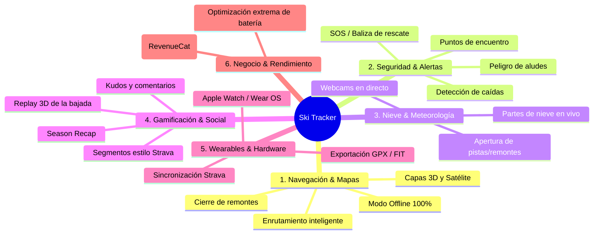

# 🗺️ Roadmap de Producto - Ski Tracker

Bienvenido a la hoja de ruta (**Roadmap**) integral de **Ski Tracker**. Este documento recopila todas las funcionalidades, mejoras técnicas y casos de uso de alto impacto organizados en formato de lista de tareas (**TODO**) para facilitar el seguimiento del desarrollo y convertir la app en la plataforma de referencia para deportes de nieve y actividades outdoor.

---

## 🧭 Visión del Producto

Evolucionar de un registrador de rutas GPS a un **asistente integral e inteligente de montaña y outdoor**:
- **En pistas:** Navegación guiada, seguridad activa, optimización del tiempo de esquí y mapas 100% offline.
- **En comunidad:** Experiencia social compartida, retos grupales, tablas clasificatorias y seguridad mutua.
- **Post-actividad:** Analítica visual avanzada (replay 3D, desgloses por pista, perfiles altimétricos y resúmenes compartibles).
- **Todo el año:** Soporte multi-deporte (senderismo, ciclismo, viajes) manteniendo el invierno como núcleo de máxima especialización.



---

## 📊 Estado Actual vs. Próximas Fases

| Área | Estado Actual (v1.x - v2.0-beta) | Próximo Salto Cualitativo |
| :--- | :--- | :--- |
| **Tracking** | Multi-actividad, segmentación nieve vs outdoor, HUD dinámico, buffer SQLite | Algoritmo adaptativo en frío (-10°C), menor consumo GPS, detección de paradas inteligente |
| **Mapas & Pistas** | MapLibre (2D/3D con sombras DEM), POIs y servicios, cálculo de rutas Dijkstra con filtros por nivel, clima y rapidez, paquetes offline 100% descargables por estación con soporte completo en mapa y tracking | Visualización de partes de nieve y estado abierto/cerrado en tiempo real |
| **Social** | Amigos, solicitudes, feed comunitario básico, live location en mapa | Reacciones (kudos), comentarios, leaderboards por estación, puntos de encuentro |
| **Meteo** | Integración básica Open-Meteo (temperatura, viento, rachas) | Partes de nieve (snow reports), webcams integradas, cota de nieve en tiempo real |
| **Analítica** | Métricas agregadas (desnivel, velocidad máx/media, lista de bajadas) | Reproductor 3D de ruta (Relive), comparador de bajadas, segmentos cronometrados |
| **Plataformas** | React Native (Expo) Android / iOS / Web | Wearables (relojes inteligentes), exportación e importación GPX/Strava |

---

## 🏔️ 1. Navegación en Pistas y Cartografía Avanzada

- [x] **1.1 Descarga de Mapas y Pistas Offline (100% Sin Cobertura)**
  - **Utilidad:** En la alta montaña o en estaciones fuera de la UE (Andorra, Suiza, etc.), la cobertura móvil es deficiente o conlleva sobrecostes de roaming. Poder descargar una estación completa antes de salir del hotel es crítico.
  - **Detalle de Implementación:**
    - [x] **Frontend:** Descarga local de paquetes con teselas vectoriales (MBTiles) y geometrías GeoJSON de pistas, remontes y POIs en el dispositivo. La idea es que al funcionar offline no se compruebe tokens, pero tampoco sean visibles las pestañas que requieren internet, solamente el tracking y el mapa. Se debe poder navegar entre las pestañas de mapa y tracking, por ejemplo, para ver los pois en el mapa y ver las bajadas actuales que llevo en el tracking.
    - [x] **Backend:** Endpoint para empaquetar o servir paquetes offline pre-generados por estación (`/api/v1/resorts/:id/offline-pack`).
  - **Prioridad:** 🔴 Alta | **Complejidad:** L

- [x] **1.2 Enrutamiento Guiado por Nivel de Habilidad (Smart Ski Routing)**
  - **Utilidad:** Mejorar el calculador de rutas existente con filtros prácticos:
    - [x] *"Ruta fácil / debutantes":* Evitar estrictamente pistas rojas y negras.
    - [x] *"Ruta rápida":* Minimizar tiempo de remontes lentos (priorizar telesillas desembragables y telecabinas).
    - [x] *"Ruta con mal tiempo":* Evitar remontes abiertos a cotas altas con viento.
    - [x] *"Volver a la base antes del cierre":* Calcular automáticamente a qué hora emprender el regreso hacia el coche/apartamento.
  - **Detalle de Implementación:**
    - [x] Ajuste de pesos en el grafo de enrutamiento ([`ski-routing.util.ts`](file:///home/development/projects/ski-tracker/apps/web/utils/ski-routing.util.ts)) ponderando la dificultad de pistas y tipología de remontes.
  - **Prioridad:** 🔴 Alta | **Complejidad:** M

- [x] **1.3 Alerta de Cierre de Remontes**
  - **Utilidad:** Los remontes cierran habitualmente entre las 16:15 y las 17:00. Si un esquiador se encuentra en otro valle, corre el riesgo de quedarse atrapado. La app alerta con antelación: *"Debes tomar el remonte X antes de las 16:10 para regresar a tu zona de origen"*.
  - **Prioridad:** 🟡 Media | **Complejidad:** M

- [x] **1.4 Renderizado de Relieve 3D con Sombras de Terreno (Terrain Mesh)**
  - **Utilidad:** Visualizar en MapLibre la pendiente real y las crestas montañosas mediante teselas DEM (Digital Elevation Model), facilitando la orientación en valles complejos.
  - **Prioridad:** 🟢 Baja | **Complejidad:** M

---

## 🛡️ 2. Seguridad en Montaña y Rescate (Safety First)

- [ ] **2.1 Detección Automática de Caídas / Impactos (Crash Detection)**
  - **Utilidad:** Detectar deceleraciones bruscas o caídas a alta velocidad mediante los sensores del smartphone (acelerómetro y giroscopio) seguidas de inmovilidad.
  - **Flujo:**
    - [ ] 1. La app emite una alarma sonora y vibración con una cuenta atrás de 45 segundos.
    - [ ] 2. Si el usuario no cancela la alerta, se activa el protocolo de emergencia (envío de SMS o notificación push con coordenadas exactas a los amigos o contactos de confianza).
  - **Prioridad:** 🟡 Media | **Complejidad:** L

- [ ] **2.2 Baliza SOS y Enlace Rápido 112 / Pistas**
  - **Utilidad:** Botón de auxilio rápido que muestra en pantalla completa:
    - [ ] Coordenadas geográficas exactas en formato estándar de rescate (grados, minutos y segundos).
    - [ ] Nombre de la pista actual y estación donde se encuentra.
    - [ ] Teléfono directo de los servicios de socorro en pistas de la estación activa.
    - [ ] Envío automático de SMS / WhatsApp a contactos de emergencia preconfigurados con un clic.
  - **Prioridad:** 🔴 Alta | **Complejidad:** S

- [ ] **2.3 Puntos de Encuentro Grupales en el Mapa ("Meeting Points")**
  - **Utilidad:** Fijar un punto geográfico temporal en el mapa (ej. *"Comida en Restaurante Borreguiles a las 14:00"* o *"Nos vemos abajo del telesilla"*).
  - **Detalle:** Visible en tiempo real para todos los amigos del grupo, mostrando la distancia y la ruta de esquí para llegar.
  - **Prioridad:** 🟡 Media | **Complejidad:** S

---

## ❄️ 3. Información de Nieve, Meteorología y Estación

- [ ] **3.1 Partes de Nieve y Estado de Pistas en Tiempo Real**
  - **Utilidad:** Proporcionar información oficial y de la comunidad sobre la estación:
    - [ ] Espesor de nieve acumulada (base y cumbre).
    - [ ] Tipo y calidad de nieve (polvo, dura, húmeda, primavera).
    - [ ] Número de pistas y remontes abiertos vs. totales.
    - [ ] Fecha y centímetros de la última nevada.
  - **Prioridad:** 🔴 Alta | **Complejidad:** M

- [ ] **3.2 Webcams en Directo de la Estación**
  - **Utilidad:** Añadir en la ficha de cada estación un carrusel de webcams en directo para comprobar visibilidad, estado de las nubes y afluencia en remontes.
  - **Detalle:** Integración de enlaces de streaming o capturas estáticas actualizadas periódicamente (vía scraping o APIs públicas de estaciones).
  - **Prioridad:** 🟡 Media | **Complejidad:** S

- [ ] **3.3 Boletín de Peligro de Aludes (BPA) y Cotas Críticas**
  - **Utilidad:** Vital para practicantes de esquí de travesía y freeride. Mostrar la escala europea de riesgo de aludes (1 a 5), laderas y orientaciones peligrosas según informes de AEMET / agencias meteorológicas locales.
  - **Prioridad:** 🟢 Baja | **Complejidad:** M

---

## 🎮 4. Gamificación, Retos y Análisis Post-Sesión

- [ ] **4.1 Reproducción 3D / Relive de la Sesión (3D GPS Flyover)**
  - **Utilidad:** Al finalizar una jornada, generar una animación interactiva en 3D sobrevolando la montaña que muestre la trayectoria recorrida, destacando las bajadas más rápidas y los desniveles alcanzados.
  - **Impacto:** Función altamente viral para compartir en redes sociales y generar atracción orgánica de usuarios.
  - **Prioridad:** 🟡 Media | **Complejidad:** XL

- [ ] **4.2 Segmentos Cronometrados y Clasificaciones Locales (Estilo Strava)**
  - **Utilidad:** Detección automática en el backend cuando un esquiador completa una pista completa o un sector emblemático (ej. *"Pista El Río en Sierra Nevada"* o *"Tres Hombres en Formigal"*).
  - **Detalle:**
    - [ ] Tablas de clasificación diarias, semanales y de temporada (tiempo de bajada, velocidad media y velocidad máxima).
    - [ ] Leaderboard privado entre amigos y leaderboard general de la estación.
  - **Prioridad:** 🟡 Media | **Complejidad:** L

- [ ] **4.3 Sistema de Insignias y Logros (Badges)**
  - **Utilidad:** Fomentar el uso continuado de la aplicación mediante logros desbloqueables:
    - [ ] 🚀 *"Club de los 80 km/h"* / *"Club de los 100 km/h"*: Superar dicha velocidad punta.
    - [ ] 🏔️ *"El Everest"*: Superar 8.848 metros de desnivel negativo esquiado en una sola jornada.
    - [ ] 🌐 *"Coleccionista de Estaciones"*: Esquiar en 5 estaciones diferentes.
    - [ ] 🌅 *"Primeras Huellas"*: Iniciar la primera bajada antes de las 9:15 AM.
    - [ ] 🎯 *"El Conquistador"*: Completar el 100% de las pistas de una estación en una misma temporada.
  - **Prioridad:** 🟡 Media | **Complejidad:** M

- [ ] **4.4 Resumen Anual / De Temporada ("Season Recap")**
  - **Utilidad:** Al finalizar el invierno (o el año deportivo), generar una infografía visual descargable lista para compartir en Instagram Stories / TikTok:
    - [ ] Total de días en pistas.
    - [ ] Kilómetros esquiados y desnivel vertical acumulado.
    - [ ] Velocidad punta del año.
    - [ ] Estación favorita y pistas más repetidas.
  - **Prioridad:** 🟡 Media | **Complejidad:** S

---

## 👥 5. Comunidad, Social e Interacciones

- [ ] **5.1 Reacciones (Kudos) y Comentarios en Sesiones**
  - **Utilidad:** Dinamizar el feed comunitario ([`community.tsx`](file:///home/development/projects/ski-tracker/apps/web/app/(ski-tracker)/community.tsx)) permitiendo que amigos y otros usuarios interactúen con las actividades subidas:
    - [ ] Reacciones temáticas: 🔥 (Fuego / Bajadón), ⛷️ (Esquí), ❄️ (Nieve), 👏 (Aplausos).
    - [ ] Hilos de comentarios con menciones (@usuario).
  - **Prioridad:** 🔴 Alta | **Complejidad:** M

- [ ] **5.2 Grupos y "Crews" de Esquí**
  - **Utilidad:** Crear grupos de amigos para viajes o escapadas de fin de semana (ej. *"Viaje a Baqueira 2026"*):
    - [ ] Marcadores de ubicación en vivo solo visibles entre los miembros del grupo.
    - [ ] Álbum fotográfico colaborativo de la jornada.
    - [ ] Ranking interno de la escapada (quién bajó más rápido, quién hizo más kilómetros).
  - **Prioridad:** 🟡 Media | **Complejidad:** M

- [ ] **5.3 Modo Fantasma Temporal (Ghost Mode)**
  - **Utilidad:** Permitir al usuario desactivar la compartición de ubicación en tiempo real con sus amigos con un solo interruptor en la pantalla de tracking, sin detener la grabación de sus métricas.
  - **Prioridad:** 🟢 Baja | **Complejidad:** S

---

## ⌚ 6. Wearables y Conectividad con el Ecosistema Deportivo

- [ ] **6.1 Aplicación Acompañante para Relojes (Apple Watch & Wear OS)**
  - **Utilidad:** Sacar el smartphone a -10°C con guantes puestos resulta incómodo y peligroso en los telesillas. Una app ligera en el reloj permite:
    - [ ] Iniciar, pausar y finalizar sesiones desde la muñeca.
    - [ ] Consultar velocidad instantánea, desnivel acumulado y bajadas completadas.
    - [ ] Capturar frecuencia cardíaca para estimar el consumo calórico exacto.
  - **Prioridad:** 🟡 Media | **Complejidad:** XL

- [ ] **6.2 Integración con Strava, Apple Health y Health Connect**
  - **Utilidad:**
    - [ ] Sincronización automática de las sesiones grabadas hacia **Strava** con datos de mapa, desnivel y calorías.
    - [ ] Lectura y escritura de entrenamientos en **Apple Health (HealthKit)** y **Google Health Connect**.
  - **Prioridad:** 🔴 Alta | **Complejidad:** M

- [ ] **6.3 Exportación e Importación de Archivos GPX / FIT / KML**
  - **Utilidad:** Permitir exportar cualquier sesión en formato `.gpx` o `.fit` para compartirla externamente o analizarla en software de terceros (Garmin Connect, Google Earth, etc.), así como importar tracks previos.
  - **Prioridad:** 🔴 Alta | **Complejidad:** S

---

## 🔋 7. Optimización de Batería, Rendimiento y Sensores

- [ ] **7.1 Perfil Térmico y Gestión de Batería en Frío Extremo**
  - **Problema:** A temperaturas bajo cero, la tensión de las baterías de iones de litio cae bruscamente.
  - **Solución:**
    - [ ] Reducción inteligente del muestreo GPS cuando el acelerómetro detecte que el usuario está estático en colas de remontes o descansando en una cafetería.
    - [ ] Modo de pantalla oscuro / OLED puro con actualización de baja tasa de refresco.
  - **Prioridad:** 🔴 Alta | **Complejidad:** M

- [ ] **7.2 Compresión y Eficiencia en la Subida de Puntos (Batch Ingestion)**
  - **Utilidad:** Un día completo de esquí genera entre 5.000 y 15.000 puntos de coordenadas. Comprimir el payload (Gzip o formato binario Protocol Buffers) reduce drásticamente el consumo de datos y agiliza la sincronización cuando la cobertura es inestable.
  - **Prioridad:** 🟡 Media | **Complejidad:** S

---

## 💎 8. Negocio y Funcionalidades del Plan PRO (Monetización)

Basado en la arquitectura definida en [`PRO_PLAN.md`](file:///home/development/projects/ski-tracker/docs/PRO_PLAN.md):

- [ ] **8.1 Integración de Pasarela de Pagos (RevenueCat):** Integración de **RevenueCat** en React Native para compras integradas en App Store y Google Play con webhooks en el backend de Go.
  - **Prioridad:** 🟡 Media | **Complejidad:** L
- [ ] **8.2 Catálogo de Funcionalidades PRO:**
  - [ ] 📦 **Mapas 100% Offline:** Descarga ilimitada de estaciones completas.
  - [ ] 📸 **Subida Ilimitada de Fotos:** Fotografías de alta resolución asociadas a las sesiones.
  - [ ] 🎥 **Replay 3D de la jornada:** Generación y exportación de vídeos 3D.
  - [ ] 📊 **Métricas Avanzadas:** Gráficos de telemetría curva a curva, cálculo de pendiente media en tiempo real y velocidad por tramos.
  - [ ] ⛅ **Meteorología Premium:** Previsión a 7 días, alertas de nieve polvo e historial de precipitaciones.

---

## 🛠️ 9. Infraestructura, DevOps y Calidad de Software

- [ ] **9.1 Pipeline de CI/CD para Compilaciones Móviles:** Automatizar la generación de APKs de prueba y subida a Google Play (Internal Testing) y Apple TestFlight mediante GitHub Actions o Jenkins.
- [ ] **9.2 Suite de Pruebas Automatizadas de Tracking (Mock Routes):** Scripts que inyecten rutas simuladas de Sierra Nevada, Formigal o Baqueira en el backend para validar que los algoritmos de segmentación de remontes/pistas no sufran regresiones.
- [ ] **9.3 Observabilidad y Monitorización:** Trazas de rendimiento en el backend (Prometheus / Grafana o Datadog) y reporte de errores en cliente (Sentry).
- [ ] **9.4 Actualización Automática de Datos de Estaciones:** Job cron periódico (en [`seed-database.py`](file:///home/development/projects/ski-tracker/seed/seed-database.py)) para actualizar pistas y remontes desde OpenStreetMap de forma incremental.

---

## 🎯 Plan de Acción Recomendado (Siguientes Pasos)

Para maximizar el impacto con el menor tiempo de desarrollo, se recomienda abordar las tareas en el siguiente orden:

```
┌────────────────────────────────────────────────────────┐
│ PASO 1: Quick Wins y Calidad de Vida (1-2 semanas)     │
│  ├─ Exportación GPX de sesiones                        │
│  ├─ Botón SOS Inteligente (Coordenadas y llamada 112) │
│  └─ Reacciones (Kudos) en el Feed Comunitario          │
└────────────────────────────────────────────────────────┘
                           │
                           ▼
┌────────────────────────────────────────────────────────┐
│ PASO 2: Mapas Offline & Meteorología (3-4 semanas)     │
│  ├─ Descarga de paquetes offline por estación          │
│  ├─ Partes de nieve y webcams en directo               │
│  └─ Filtros de nivel en el calculador de rutas         │
└────────────────────────────────────────────────────────┘
                           │
                           ▼
┌────────────────────────────────────────────────────────┐
│ PASO 3: Gamificación y Modelo de Negocio (4-6 semanas) │
│  ├─ Segmentos cronometrados / Leaderboards             │
│  ├─ Integración de RevenueCat (Plan PRO)               │
│  └─ Replay 3D de la jornada                            │
└────────────────────────────────────────────────────────┘
```

### Checklist de Ejecución Rápida
- [ ] **Paso 1: Quick Wins y Calidad de Vida (1-2 semanas)**
  - [ ] Exportación GPX de sesiones
  - [ ] Botón SOS Inteligente (Coordenadas y llamada 112)
  - [ ] Reacciones (Kudos) en el Feed Comunitario
- [ ] **Paso 2: Mapas Offline & Meteorología (3-4 semanas)**
  - [x] Descarga de paquetes offline por estación
  - [ ] Partes de nieve y webcams en directo
  - [x] Filtros de nivel en el calculador de rutas
- [ ] **Paso 3: Gamificación y Modelo de Negocio (4-6 semanas)**
  - [ ] Segmentos cronometrados / Leaderboards
  - [ ] Integración de RevenueCat (Plan PRO)
  - [ ] Replay 3D de la jornada

---

> [!TIP]
> Puedes consultar la documentación técnica detallada en la carpeta [`docs/`](file:///home/development/projects/ski-tracker/docs/):
> - [`ROADMAP_V2.md`](file:///home/development/projects/ski-tracker/docs/ROADMAP_V2.md) (Arquitectura multi-actividad y seguimiento outdoor).
> - [`FRIENDS_SYSTEM.md`](file:///home/development/projects/ski-tracker/docs/FRIENDS_SYSTEM.md) (Sistema social y amigos).
> - [`TRACKING.md`](file:///home/development/projects/ski-tracker/docs/TRACKING.md) (Pipeline heurístico y GIS de detección de bajadas).
> - [`PRO_PLAN.md`](file:///home/development/projects/ski-tracker/docs/PRO_PLAN.md) (Diseño de licencias y pasarela de pago).
