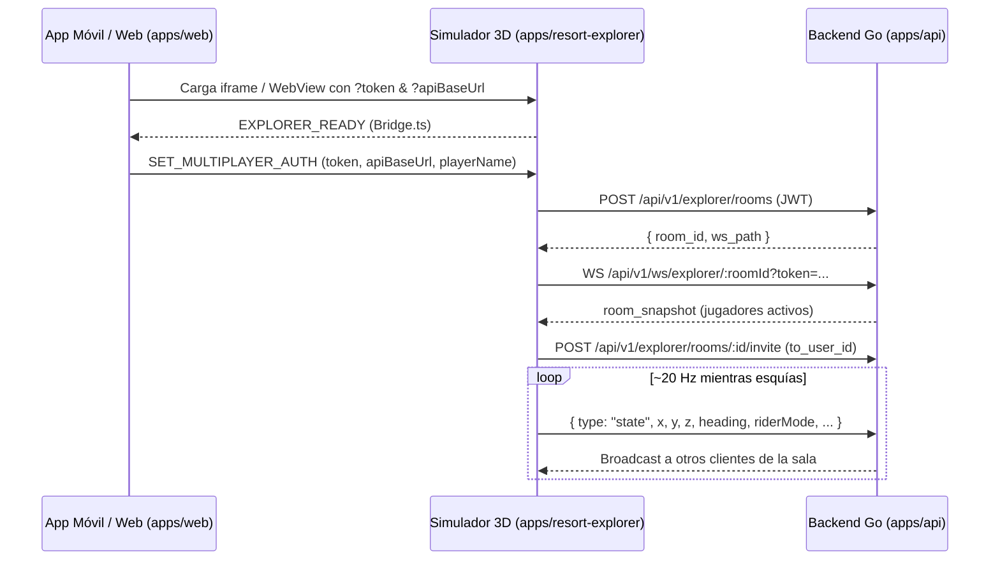

# 👥 Multijugador en Tiempo Real · Explorador 3D (`10.16`)

Documentación técnica de la arquitectura multijugador del simulador 3D (`apps/resort-explorer`), su integración con la app móvil/web (`apps/web`) y el Hub WebSocket en Go (`apps/api`).

---

## 🧭 Visión General

El sistema permite que varios amigos de **Ski Tracker** entren en una **misma sala** dentro de una estación de esquí en el simulador 3D, vean sus avatares esquiando o haciendo snowboard en tiempo real, aparezcan en el minimapa táctico y puedan teletransportarse junto a cualquier compañero.



---

## 🎮 Cómo Esquiar con Amigos (Guía para Jugadores)

### Paso 1 · Entrar al Explorador 3D
1. Inicia sesión en la app **Ski Tracker**.
2. Entra en la nueva pestaña **3D** (en la barra inferior) o abre cualquier estación desde **Estaciones → Ver en 3D**.
   - Tu usuario y tu lista de amigos se conectan automáticamente al simulador.
3. Si abres desde la pestaña **3D**, selecciona la estación en el mapa inicial.

### Paso 2 · Crear una Sala e Invitar Amigos (Anfitrión)
1. Pulsa el botón **👥 Amigos** en la esquina superior izquierda del HUD.
2. Pulsa **🏔️ Crear Sala** (se generará un código de sala, por ejemplo `#a1b2c3d4`).
3. En la sección **Tus amigos**, pulsa **Invitar** junto al amigo con el que quieras esquiar.
   - *(También puedes pasarle el código de sala directamente si queréis entrar manualmente).*

### Paso 3 · Unirse a la Sala (Amigo Invitado)
1. Tu amigo entra en la pestaña **3D** (y selecciona la misma estación).
2. Pulsa **👥 Amigos**.
3. En **Invitaciones recibidas** verá tu invitación con el nombre de la estación y el botón **Unirse** (o puede escribir el código de sala y pulsar **Unirse**).

### Paso 4 · Esquiar Juntos, Ubicarse y Reagruparse
- **Verse en pistas:** verás el avatar 3D de tu amigo (con esquís o snowboard según lo que lleve equipado) y su nombre + velocidad flotando encima.
- **Minimapa táctico (`M`):** los amigos conectados aparecen como **puntos verdes** en el minimapa de la esquina y con su nombre en el plano ampliado.
- **Reagruparse al instante:** si os separáis en la montaña, abre **👥 Amigos** y pulsa **📍 Ir con amigo** para teletransportarte justo a su lado.
- **Salir de la sala:** abre **👥 Amigos** y pulsa **Salir de Sala** para volver al modo individual.

---

## 1. Backend Go (`apps/api`)

Implementado en [`explorer_multiplayer_handler.go`](file:///home/dev/projects/ski-tracker/apps/api/internal/api/v1/explorer_multiplayer_handler.go) y registrado en [`router.go`](file:///home/dev/projects/ski-tracker/apps/api/internal/server/router.go).

### 1.1 Rutas REST (protegidas con `middleware.Auth`)
| Método | Ruta | Descripción |
| :--- | :--- | :--- |
| `POST` | `/api/v1/explorer/rooms` | Crea una sala en memoria (`room_id` de 8 caracteres) asociada a `resort_id` y `resort_name`. |
| `POST` | `/api/v1/explorer/rooms/:id/invite` | Crea una invitación para `to_user_id` (expira a los 30 minutos). |
| `GET` | `/api/v1/explorer/invites` | Lista las invitaciones activas recibidas por el usuario autenticado. |
| `DELETE` | `/api/v1/explorer/invites/:id` | Descarta una invitación concreta. |

### 1.2 WebSocket en vivo (`middleware.WSAuth`)
- **Ruta:** `GET /api/v1/ws/explorer/:roomId?token=<JWT>&resortId=<id>&name=<displayName>`
- **Tecnología:** `golang.org/x/net/websocket` sobre el router de Gin.
- **Límite por sala:** máximo **16 jugadores** simultáneos en una misma sala (`room.clients`).
- **Ciclo de mensajes:**
  1. Al conectar, si la sala no existe se auto-crea; el servidor envía `room_snapshot` con el estado actual de los demás jugadores conectados.
  2. Difunde `join` al resto de la sala.
  3. Cada paquete `state` recibido de un cliente actualiza su último estado en la sala y se reenvía al resto (`broadcastExcept`) sin bloquear si algún cliente va lento (canal con buffer de 32 mensajes).
  4. Al desconectar, elimina al jugador de la sala (y borra la sala si queda vacía) y difunde `leave`.

### 1.3 Formato del paquete `ExplorerPlayerState`
```json
{
  "type": "state",
  "userId": "uuid",
  "name": "Nombre",
  "x": 124.5,
  "y": 48.2,
  "z": -310.8,
  "heading": 1.42,
  "speedKmh": 54,
  "riderMode": "ski",
  "stance": "regular",
  "roll": -0.22,
  "crouch": 0.35,
  "skidAngle": 0,
  "isGrounded": true,
  "ridingLiftName": ""
}
```

---

## 2. Cliente 3D (`apps/resort-explorer`)

Implementado en [`MultiplayerManager.ts`](file:///home/dev/projects/ski-tracker/apps/resort-explorer/src/engine/MultiplayerManager.ts), [`SceneManager.ts`](file:///home/dev/projects/ski-tracker/apps/resort-explorer/src/engine/SceneManager.ts) y [`TacticalMinimap.ts`](file:///home/dev/projects/ski-tracker/apps/resort-explorer/src/engine/TacticalMinimap.ts).

### 2.1 Sincronización e Interpolación a 60 FPS
- **Envío local (`sendLocalState`):** limitado a **~20 Hz** (cada `50 ms`) para reducir tráfico de red sin perder fluidez.
- **Interpolación remota (`update`):** cada amigo conectado (`RemotePeer`) tiene un `SkierAvatar` completo (esquí o snowboard *regular*/*goofy*) y un *nametag* 3D (`THREE.Sprite`) con nombre y velocidad. En cada frame a 60 FPS se interpolan suavemente `position` (`lerp`), `heading` (camino angular más corto), `roll`, `crouch` y `skidAngle`, llamando a `avatar.updatePose(...)`.

### 2.2 Minimapa y Teletransporte
- `TacticalMinimap.setRemotePeers(...)` dibuja puntos verdes en el minimapa de esquina y marcadores con tooltip permanente en el plano táctico ampliado.
- En el modal **👥 Amigos** (`#friends-mp-overlay` en [`index.html`](file:///home/dev/projects/ski-tracker/apps/resort-explorer/index.html) / [`main.ts`](file:///home/dev/projects/ski-tracker/apps/resort-explorer/src/main.ts)), cada amigo conectado muestra un botón **📍 Ir con amigo** que ejecuta `manager.teleportToPeer(userId)`.

---

## 3. Puente App Móvil / Web (`apps/web`)

Implementado en [`explorer.tsx`](file:///home/dev/projects/ski-tracker/apps/web/app/(ski-tracker)/explorer.tsx), [`resort-explorer-modal.tsx`](file:///home/dev/projects/ski-tracker/apps/web/components/resorts/resort-explorer-modal.tsx) y [`constants.ts`](file:///home/dev/projects/ski-tracker/apps/web/constants/constants.ts).

- **Web:** renderiza un `<iframe>` apuntando a `EXPLORER_URL`. Como `expo-sqlite` activa `Cross-Origin-Embedder-Policy: credentialless` en [`app.json`](file:///home/dev/projects/ski-tracker/apps/web/app.json), tanto [`vite.config.ts`](file:///home/dev/projects/ski-tracker/apps/resort-explorer/vite.config.ts) como [`nginx.conf`](file:///home/dev/projects/ski-tracker/apps/resort-explorer/nginx.conf) sirven `Cross-Origin-Resource-Policy: cross-origin` y `Cross-Origin-Embedder-Policy: credentialless`.
- **Móvil nativo (iOS / Android):** renderiza `<WebView>` (`react-native-webview`) y resuelve automáticamente la IP LAN del equipo en desarrollo mediante `Constants.expoConfig?.hostUri` (o `10.0.2.2` en emulador Android).
- **Paso de autenticación:** envía `token`, `apiBaseUrl` y `playerName` tanto por query params en la URL como por `postMessage` (`SET_MULTIPLAYER_AUTH`) al recibir `EXPLORER_READY` o al terminar la carga.

---

## 4. Desarrollo y Despliegue
- **Desarrollo local:** `make dev` arranca Docker (`postgres` + `minio`), la API Go (`:8082`), Expo Web y `resort-explorer` (`:5174`).
- **Producción:** [`Jenkinsfile.explorer`](file:///home/dev/projects/ski-tracker/Jenkinsfile.explorer) construye [`Dockerfile`](file:///home/dev/projects/ski-tracker/apps/resort-explorer/Dockerfile) y despliega el servicio `explorer` definido en [`docker-compose.yaml`](file:///home/dev/projects/ski-tracker/deploy/docker-compose.yaml).
